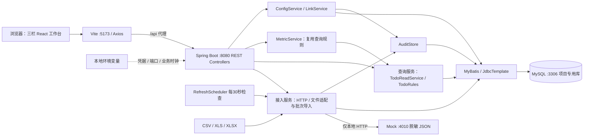
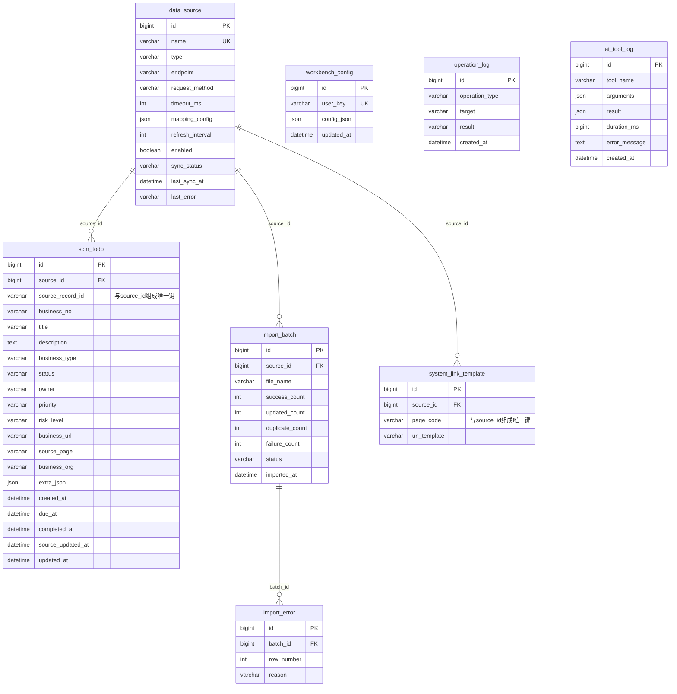
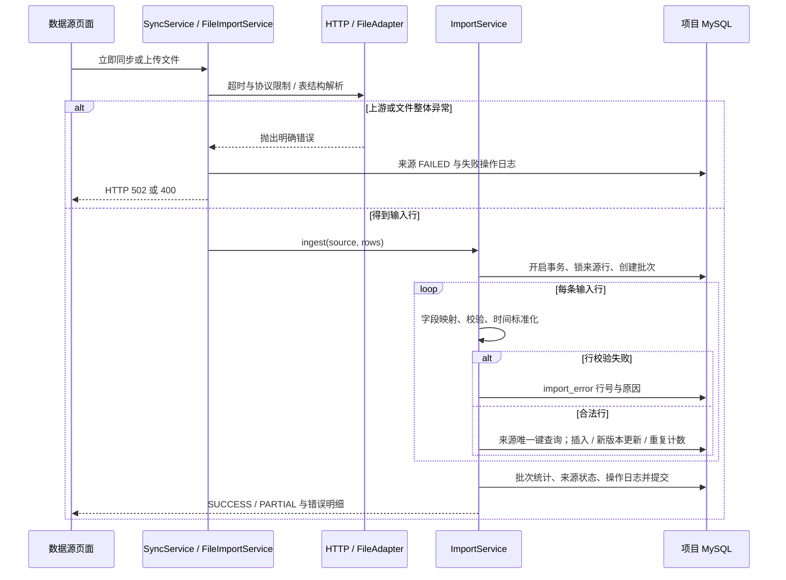

# 核心业务审查、质量回归与周四验收准备

## 资料和范围

本轮本地阅读了桌面 docs 中的《实习说明》《实习计划表》《实习任务书｜AI 驱动的可配置 SCM 统一工作台》《项目总结材料要求》，重新核对仓库已确认的需求与工程设计。原始资料及凭据未复制进仓库。计划要求周二完成业务工作台、周三完成 AI 闭环；本轮实现前者与人工配置，不宣称全部 P0 已完成。

原任务书要求八个导航：我的工作台、采购待办、库存异常、供应商协同、数据分析、工作台配置、数据源配置、操作日志。已统一名称和默认配置。最终提交、总结、演示材料及 AI 六工具闭环仍需后续完成。

## 第一轮审查与修复

| 原问题                                             | 本轮处理                                                                       |
| -------------------------------------------------- | ------------------------------------------------------------------------------ |
| 待办模型缺描述、来源页面、业务组织和扩展信息       | 增量增加 description、source_page、business_org、extra_json                    |
| 没有完成时间，无法准确计算处理时长、按时完成率     | 增加 completed_at；完成态必须有合法完成时间                                    |
| 数据源缺运行状态、刷新开关、最后同步和错误信息     | 补 enabled、sync_status、last_sync_at、last_error                              |
| 导入结果不能区分更新和重复                         | 增加 updated_count、status；成功数包含新增与更新，重复数单列                   |
| 第一轮 DATETIME 秒精度可能破坏带小数秒来源的幂等性 | 核心业务时间改为 DATETIME(6)，转换统一截断到微秒；重复导入测试覆盖             |
| 设计“即将逾期”上界与原任务书存在差异               | 以原任务书为准：未完成且 0 ≤ 剩余时间 < 配置阈值；精确上界不算即将逾期         |
| 统计和待办尚未实现，潜在多口径风险                 | 统一 TodoRules；指标一次读取数据快照、时间与阈值，避免单次响应内跨刷新口径变化 |
| Ant Design 5 + React 19 静态消息不兼容             | 官方兼容包 + AntApp 上下文消息；浏览器验证保存成功提示                         |
| 首轮“未就绪”页面                                   | 替换为可操作业务页面；删除旧空图表与静态导航重复定义                           |

保留八张表和已有外键，不覆盖原有表或数据，不需要架构推翻。迁移仅作用于项目库，项目专用账号补充 ALTER 权限。初始化脚本只忽略重复列错误，不忽略其他 DDL 失败。

## 实际部署架构（2026-11-17）

以下为当前主工作区实际实现；AI 独立 Worktree 尚未合入，不代表 AI 架构或调用验证已完成。

进程边界为 MySQL、Mock、Spring Boot、Vite；后端仍是单体分层，不包含消息队列或微服务。服务监听回环地址。配置通过 Zustand 分发，业务请求统一经 Axios。`ai_tool_log` 仅为预留表，本轮未验证其写入。

## 模块边界及调用链

- SourceController → SourceService / SourceStore：配置校验与持久化。
- SyncService → ConfiguredHttpAdapter → TodoConverter → ImportService → TodoMapper / MySQL：HTTP 接入。
- ImportController → FileImportService → FileAdapter → 同一转换与入库服务：CSV/XLS/XLSX。
- TodoController → TodoReadService → TodoRules / TodoMapper：查询与派生逾期字段。
- MetricController → MetricService → 同一 TodoReadService / TodoRules：指标、分布和趋势。
- ConfigController → ConfigService：人工配置持久化；后续 AI 调用业务服务，不能绕过确认层。
- LinkController → LinkService → 模板 + 待办服务 + AuditStore：变量编码、URL 校验、解析日志。
- React 页面 → Axios /api → Vite 代理 → REST；Zustand 管理配置，页面、图表、列表、AI 占位面板分离。

`scm_todo(source_id, source_record_id)` 唯一；模板 `(source_id,page_code)` 唯一。配置使用本地演示用户 `demo`，未实现认证和多用户隔离（任务书不要求完整权限中心）。

### HTTP / 文件入库核心链路

数据库异常回滚整个批次；行校验异常只跳过该行。人工配置与日志在同一事务，审计失败则配置不生效。指标卡 `metric` → `/metrics/summary`；点击带 `view=metric`、时间窗口和筛选条件 → `/todos`；两条路径都复用 TodoRules。系统链接解析读取待办和模板，编码四个变量，验证最终 URL 后写 SYSTEM_JUMP 日志，只表达跳转意图。

## 工作台配置逐项核对

| 原任务书配置项                           | 实际持久化与呈现                                                     | 回归依据                                                 |
| ---------------------------------------- | -------------------------------------------------------------------- | -------------------------------------------------------- |
| 卡片显示、名称、顺序、颜色、图标         | `cards` 对应字段；按序显示；app/chart/link 三种图标                  | 严格字段校验、浏览器改名保存与刷新                       |
| 指标数据来源                             | `metric` 可选十项核心指标；`key` 保持组件身份；旧配置回退到 key      | MySQL 保存读取、前端规则测试、浏览器切换为逾期后20条下钻 |
| 点击行为、时间范围、刷新频率             | DETAIL/NONE；1～365天；10～3600秒，各卡按自身频率轮询                | 参数边界测试、分组调度策略测试；3600秒整周期未做墙钟等待 |
| 导航名称、上级、图标、排序、内外链、启用 | 递归按父子顺序排列、层级缩进；隐藏父级同时隐藏子级；页脚保留配置入口 | 循环/缺父级校验、前端多层及隐藏测试                      |
| 快捷入口名称、图标、URL、AI提示词、顺序  | 人工配置并持久化；URL跳转；提示词为标题提示                          | URL/提示词类型与长度校验；正式AI执行待独立会话验证       |
| 基础布局、默认过滤/时间、AI展开          | 卡片显示与顺序、LIST/ANALYTICS、默认负责人/天数、aiExpanded          | 配置接口回归；清空负责人显式覆盖默认值                   |

未增加任意拖拽网格；当前基础布局为任务书所列卡片显示/顺序和默认视图。配置入口为固定人工表单，非通用可视化页面设计器。

## 数据口径

- 时间：业务规则使用注入 Clock，Asia/Shanghai；日期字符串无偏移时按上海时间解释，有偏移时转换。验收固定为 2026-11-17 12:00:00 +08:00。运行健康检查、定时刷新与审计时间使用实际机器时间。
- 未完成：状态不为 COMPLETED。待办总数、高风险、逾期、即将逾期、今日到期均限未完成；今日新增包含当天创建的全部状态。
- 本周完成：周一 00:00 至业务当前时刻；平均时长为完成减创建；按时完成率为完成时间 ≤ 要求完成时间的完成任务占比。无完成任务时两个比率/均值返回 null，不伪造 0。
- `days` 指最近 N 个自然日内创建（截至业务当前时刻）的记录，各指标卡可设置自己的窗口；点击卡片携带该窗口进入明细。时间默认不由后端隐式加筛选。
- 趋势为按创建日期的记录数量，不冒充历史逾期快照；分布和图表明细使用相同组合条件。
- 相同来源主键：新记录插入；来源更新时间更晚则更新；时间相同或更早则作为重复/旧版本跳过。时间精度统一微秒。不删除来源中本次未出现的历史记录。
- 批次对来源行加数据库锁，防止同来源并发插入竞争。合法行正常入库，校验错误写 import_error；真实数据库写入异常回滚批次，不被作为校验错误吞掉。
- CSV 行号是含表头的逻辑记录序号；Excel 是工作表实际行号。读取第一个工作表，不执行公式；公式行报告错误。文件上限 5MB、10000 行；损坏文件整体拒绝，记录失败来源状态与操作日志。
- HTTP GET/POST；仅允许配置项目 Mock 回环地址和端口，禁止自动跟随重定向，避免生产访问。自动刷新开启后每 30 秒检查一次是否达到配置分钟间隔；失败有持久化状态和日志。

## 实际验证结果

2026-11-17 质量回归：后端集中验证 29 项测试，0 失败、0 错误、0 跳过。包括真实 MySQL、日期边界、组合筛选、配置 URL 校验、映射及时区转换、CSV 部分成功、重复及新旧版本、微秒幂等、XLS/XLSX、公式错误、深链接、定时刷新失败状态。业务数据测试使用事务回滚；另有 3 项无外层测试事务的故障注入验证业务服务自身事务确实回滚，未留下测试数据。

`./scripts/verify.sh` 通过：Maven verify、前端 3 项策略测试、启停拒绝路径 2 项测试、TypeScript、生产构建、Mock HTTP 1 项测试、双次初始化、健康检查、代理与适配器、OpenAPI、参数校验。

`python3 scripts/acceptance.py` 连续两次通过：真实 HTTP GET/POST 同步、CSV/Excel 上传、重复导入、错误行、10 项指标及其他查询、组合筛选、趋势/分布明细核对、链接、配置持久化、来源 503 转 502、故障期间原数据保留。独立 MySQL 聚合核对成功，两次运行后仍为100条，审计与导入批次按实际操作追加。

| 固定验收项          |                  实际数量 |
| ------------------- | ------------------------: |
| 入库记录            |                       100 |
| 来源 / 业务类型     |                     2 / 3 |
| 未完成 / 已完成     |                   80 / 20 |
| 今日新增 / 今日到期 |                   15 / 15 |
| 逾期 / 即将逾期     |                   20 / 15 |
| 未完成高风险        |                         8 |
| 待审核 / 待回复     |                   10 / 10 |
| 本周完成            |                        20 |
| 平均处理时长        |                  106 小时 |
| 按时完成率          |                       50% |
| 链接模板            |                        10 |
| 固定错误记录        | 3（CSV 第 42、43、44 行） |

浏览器验证：指标 20 条逾期 → 图表采购 7 条 → 高风险 3 条；列表/分析视图；任务详情和四变量深链接；人工修改卡片名称、保存、刷新后保留，再恢复名称；页面点击 HTTP 同步重复 60 条；浏览器 CSV 上传重复 40 条、失败 3 条及具体原因。兼容修复后保存提示正常。

格式：Google Java Format 1.17.0，Prettier 3.6.2，Black；TypeScript 严格检查和 Git diff 空白检查。运行证据仅存 `.runtime/`（不提交）。

## 本轮缺陷修复及测试证据

| 实际缺陷                                     | 修复与验证                                                           |
| -------------------------------------------- | -------------------------------------------------------------------- |
| 卡片来源只能由固定标识决定，无法人工修改     | 独立 metric 字段；兼容旧配置；浏览器保存刷新后显示20、下钻20         |
| 所有卡片被统一频率刷新，超过60秒设置无效     | 按时间窗口及各卡频率分组；前端测试覆盖不同频率、隐藏卡及相同分组合并 |
| 上级导航只是单级缩进，隐藏父级仍显示子级     | 递归排序与隐藏继承；测试三层及非法循环                               |
| 默认负责人不能在筛选栏清空，关键词重置后残留 | URL保留空owner、搜索框跟随筛选重置                                   |
| 部分指标下钻显示内部枚举                     | 补齐待审核、待回复、时长和完成率等中文视图名                         |
| 配置接受小数/数字字符串等隐式转换            | 数字、布尔、名称、图标、提示词严格类型/范围校验                      |
| 来源与链接配置可能在审计失败后仍被保存       | 增加服务事务；真实MySQL故障注入3项通过                               |
| 部分服务PID状态可能被误报全部健康            | status要求三个服务齐全；隔离临时目录测试部分状态与端口占用拒绝       |
| 验收脚本未尊重进程环境覆盖                   | 与启停脚本统一环境优先级，不修改.env                                 |

测试分布：ApiTest 2、AuditConsistencyTest 3、BusinessIntegrationTest 13、DatabaseIntegrationTest 1、HttpAdapterTest 4、TodoRulesTest 6。HTTP专测覆盖POST、畸形JSON、重定向拒绝和读超时；异常不伪装为空数据成功。

操作日志验收同时核对 `SOURCE_CONFIG/SUCCESS`、`LINK_CONFIG/SUCCESS`、`CONFIG_UPDATE/SUCCESS`、`SYSTEM_JUMP/RESOLVED`、`HTTP_SYNC/SUCCESS|FAILED`、`FILE_IMPORT/PARTIAL|FAILED`，并验证目标与时间非空。成功导入目标为批次ID，整体失败目标为来源ID；日志不存请求正文或凭据。

实际执行了 stop → start、status 及重复start；三个HTTP服务健康检查200，MySQL连接正常；共享MySQL未停止。浏览器完成指标来源切换→保存→刷新→20条明细→恢复原配置，控制台错误/警告为空。AI没有进行真实调用。

静态检查：Java编译与Google Java Format、TypeScript严格检查、Prettier、Python Black及Git空白检查通过；未引入或宣称执行Sonar/全量安全扫描。生产构建有图表包体积警告，见下方风险。证据：`.runtime/quality-verification.log`、`quality-acceptance-1.log`、`quality-acceptance-2.log`、`quality-static.log`、`quality-browser.jpg`；JUnit XML在`backend/target/surefire-reports/`，均不提交Git。

## 周四验收顺序及待验证项

1. 按README显式固定Clock启动并执行verify、acceptance；核对100/20/15/8、2来源、3业务及10链接。
2. 展示同步/文件导入、重复计数和3条错误；临时模拟503后查看FAILED与已有记录，恢复来源。
3. 逾期20→采购7→高风险3，展示列表/统计两视图、趋势和明细联动。
4. 保存卡片来源/顺序、导航和布局后刷新；解析四变量深链接，核对操作日志。
5. AI独立Worktree合入后另做Tool Calling、六工具、二次确认、失败处理和追溯回答测试；本报告结果不覆盖该部分。
6. 待上述AI验证与最终演示完成，再补最终总结的实测结果。GitLab统一推送由用户另行安排。

## 业务轮次剩余 P0 与限制（合并前历史记录）

- 模型凭据与 Tool Calling 兼容性验证已按用户指令交由另一独立会话负责，本轮不声称已验证，也不继续修改 AI 配置或本地 .env。
- 正式 AI 对话、六工具编排、数据来源追溯回答、模型失败处理、AI 配置二次确认和 AI 调用日志待下一轮；AI 面板仅展示明确标注为业务接口计算的摘要。
- 最终总结、演示材料、完整 P0 验收和统一 GitLab 推送待当天后续安排。本轮仅本地提交。
- 本地规模实现：查询从数据库读取待办到内存共用规则过滤，适合当前 100 条演示；大数据量需分页 SQL/聚合下推及容量验证，尚未做压力测试。
- 每个查询/指标响应内部使用一致口径；不同 HTTP 请求之间不承诺跨请求事务快照。前端相同时间窗口的指标合并请求。
- 图表懒加载包仍有略大于 500kB 的构建警告，非阻断错误。
- 导航支持递归层级与隐藏继承，但编辑仍为表单，不提供拖拽树。配置存储为单用户 JSON，不提供并发编辑版本冲突控制。
- 单次损坏文件不会尝试猜测修复；合法表结构里的非法数据行才逐行处理。HTTP POST 当前无自定义请求体/认证，本项目 Mock 不需要，未扩展生产接口连接能力。

## main 集成验收（2026-11-17，本轮实测）

两个工作区检查时均干净，AI分支5fd3af3的共同基点为83ab9a9，已快进合并至main，无覆盖或冲突。未复制Worktree数据库、端口或.env。

修复：原AI将最近七天逾期定义为“七天创建且当前逾期”，改为OVERDUE_TREND：七天到期且当前仍逾期，按到期日期分布。独立MySQL逐日分组与接口、明细一致，演示用户10、演示同事10；新增3项测试覆盖创建日期与到期日期不同、日期边界、完成状态、负责人及非法窗口。此口径不是历史每日逾期存量，不声称具有历史快照。

| 第六章场景   | main 本轮结果                                                                      |
| ------------ | ---------------------------------------------------------------------------------- |
| 工作台汇总   | 通过；真实浏览器逾期卡下钻20，接口及SQL核对一致                                    |
| AI查询       | 阻塞；main模型凭据未配置，不能沿用Worktree结论                                     |
| 复杂筛选     | 业务组合筛选通过；真实模型提取与多轮待验证                                         |
| 系统跳转     | 深链接及跳转日志通过；真实模型发起待验证                                           |
| 配置修改     | 事务、会话绑定、取消/确认、重放/过期等自动化测试通过；真实模型和页面确认闭环待验证 |
| 数据源异常   | 真实503上游、后端502及原数据保留通过；AI说明缺失范围待验证                         |
| 错误数据导入 | 通过；CSV/Excel、重复和错误行；连续两次初始化仍100条                               |

main执行verify：41项后端测试，40通过、0失败、1跳过（CompanyModelTest需要真实凭据）；前端3项、生命周期2项、Mock1项、TypeScript及构建通过。实际stop/start、重复start、双次迁移及双次acceptance通过；MySQL及三个服务正常。浏览器未记录错误，未配置AI时明确提示，对话HTTP503，业务可用。

本轮证据在.runtime/integration-verify.log、integration-start.log、integration-business-1.log、integration-business-2.log、integration-browser.jpg。静态检查结果见integration-static.log。

以上表格为配置凭据前的中间记录，以以下最终复验结果为准。

### main 最终复验结果

按用户授权从本地实习说明读取凭据，只补充主项目 .env 的三个模型变量，保留其他设置，权限0600；只读核对CC Switch的地址、模型、协议及凭据一致。未修改CC Switch，未提交.env。

| 第六章场景   | 最终结果                                                                                 |
| ------------ | ---------------------------------------------------------------------------------------- |
| 工作台汇总   | 通过；卡片、图表、明细及独立SQL一致，浏览器逾期下钻20条                                  |
| AI查询       | 通过；主项目真实模型调用，个人待办40、逾期10、今日到期8，来源时间齐全；点击个人明细40条  |
| 复杂筛选     | 通过；采购逾期高风险3条；多轮改库存后保留逾期与风险条件，3条                             |
| 系统跳转     | 通过；真实工具生成rfq链接，访问200，SYSTEM_JUMP审计存在                                  |
| 配置修改     | 通过；提案未写入、取消不修改、确认持久化、重放拒绝；浏览器确认并刷新后逾期卡置首         |
| 数据源异常   | 通过；真实503来源触发502，工具显示FAILED及具体来源，提示数据可能缺失；已有80条未完成保留 |
| 错误数据导入 | 通过；合法行入库，3条错误定位，重复计数正确；两次初始化仍100条                           |

主项目最终verify为41项后端测试全部通过，0失败、0跳过，包含真实LangChain4j Responses对话及随机工具值往返。前端3项、生命周期2项、Mock1项、TypeScript、构建和全量格式检查通过。ai-acceptance.py六类工具全部通过，含配置APPLIED/CANCELLED及工具日志。

浏览器实测发现AI等待状态p内嵌Spin的div造成HTML嵌套错误，已修复为div容器；重跑前端检查及真实对话，修复后控制台错误为空。验收配置已恢复。新增证据：integration-ai.log、integration-ai-browser.jpg、integration-frontend-final.log。

当前无功能性P0阻塞。个人总结、现场代码走查与演示仍待本人完成；未做大数据压力测试；无历史每日逾期存量快照，明确使用到期日期分布；图表包体积警告非阻断。公司模型故障降级由自动化故障注入覆盖，缺少配置503已真实HTTP验证，未人为破坏公司服务。

## 界面易用性复核（2026-11-18）

本轮以桌面原始任务书 P0、6.2 七场景和已确认工程设计为依据，调整展示与操作反馈。未修改后端业务规则、模型凭据或固定验收数据，未重新执行会修改数据源和配置的整套 acceptance 脚本；上节七场景结果是 11 月 17 日 main 的真实集成记录，不冒充本轮新测。

### 修复

- 指标点击后自动定位到筛选栏，显示选中指标，支持键盘 Enter。列表和图表仍使用相同后端条件。
- 筛选说明由 JSON 改为中文，正确显示默认负责人、显式清空时间范围和“我的待办”当前用户范围。
- 任务详情字段中文化，将“生成业务深链接”和生成后的“打开业务页面”放到详情顶部；增加生成中状态，关闭或切换任务后忽略旧请求结果。
- 表格固定最小列宽，避免状态、负责人逐字竖排；增加左右滑动提示。
- 删除配置页“AI 二次确认留待下一轮”的过期说明，说明人工保存与 AI 提案确认的区别。
- 保留一处“演示环境”标识；固定样例标题在列表、风险摘要和 AI 结构化结果中简称“任务 019”等。源文件、数据库、匹配条件保持原值，详情可展开原文追踪。
- 数据源状态中文化，保留部分失败与缺失范围提示。图表标题明确是“当前结果的创建日期分布”，不让用户误认为历史每日逾期量。
- 风险区原“查看明细”实际筛选全部高风险，改为“筛选高风险任务”并自动定位；无完成任务时比率和时长显示“—”，不再显示“—%”或“—h”。

### P0 对照与实测边界

| 要求                            | 当前实现及本轮复核                                                                                                                                                   |
| ------------------------------- | -------------------------------------------------------------------------------------------------------------------------------------------------------------------- |
| 三栏、八导航、至少两视图        | App / Dashboard / AiPanel；浏览器验证列表和统计分析切换，页面入口齐全                                                                                                |
| HTTP 与 CSV/Excel 接入          | ConfiguredHttpAdapter / FileAdapter / ImportService；本轮后端集成测试覆盖正常、超时、格式、错误行、重复和更新，未修改当前来源                                        |
| 完整待办模型、视图与组合筛选    | TodoRules / TodoReadService；模型字段与任务书核对；浏览器逾期20 → 采购7 → 高风险3，SQL和接口一致                                                                     |
| 指标、趋势与明细                | 十项指标，按业务与风险分布；浏览器图表下钻通过；最近七天逾期按到期日期分布的3项测试通过，不声称历史存量快照                                                          |
| 卡片、导航、快捷入口和布局配置  | Settings / ConfigService；字段及持久化校验已核对；保留原配置，浏览器仅检查表单与说明；确认/取消/过期/冲突等自动化测试通过                                            |
| 深链接四变量、URL校验、跳转日志 | LinkService；浏览器任务006生成链接并打开本地模拟页面，业务单号和任务编号正确；自动化校验及审计测试通过                                                               |
| 六类AI工具、真实数据与二次确认  | AiTools / AiChatService / AiConfigChanges；六类工具上轮完整验证；本轮真实对话和随机工具值往返通过，浏览器个人待办查询40/逾期10/今日到期8、来源缺失提示及40条明细通过 |
| 固定验收数据和可复现性          | SQL核对100条、2来源、3类型、逾期20、今日到期15、高风险8、链接模板10；本轮双次结构迁移和脚本拒绝路径测试通过；业务数据重复初始化沿用上轮双次实测记录                  |
| 日志、异常、测试和交付          | 业务审计故障回滚、AI异常及配置确认测试通过，实测有AI工具日志；README和本记录更新；个人总结、本人现场演示和代码走查仍待完成                                           |

### 测试结果

- `./scripts/verify.sh` 成功：41 项后端测试中 40 通过，真实模型用例按默认开关跳过；随后安全加载本地环境，单独开启 `SCM_AI_LIVE_TEST=true` 执行 CompanyModelTest，真实 gpt-6.1-sol 对话和随机工具值往返通过。因此 41 项均已实际运行通过。
- 最终前端 5 项测试、TypeScript 严格检查、生产构建通过。新增展示策略测试覆盖有效默认值、显式清空、个人视图和固定样例别名边界。Mock HTTP 1 项、启停拒绝路径 2 项测试通过。
- 浏览器验证自动定位（筛选栏距视口顶部约16px）、提示、20/7/3联动、详情、深链接、AI个人40条明细和风险入口；控制台错误为空。SQL独立核对演示用户40/10/8、演示同事40/10/7，与接口一致。
- 本轮未停止用户正在使用的服务，四个服务保持正常；前端由 Vite 加载变更，用户刷新即可。未改 `.env`，未重置100条数据。验证产生必要的跳转与AI调用日志。
- 静态检查：Prettier（frontend/src、frontend/tests、README及本记录）、TypeScript严格检查和 `git diff --check` 通过；候选提交文件未匹配本地真实凭据值或私钥标记，`.env` 保持忽略。未声称执行全量安全审计。
- 证据存于忽略目录 `.runtime/usability-verify.log`、`usability-model.log`、`usability-browser.jpg`、`usability-detail.jpg`，不提交临时日志或截图。

未发现新增功能性 P0 阻塞。保留已知限制：本地单用户和小数据量；无历史每日逾期存量快照；图表包体积警告；公司模型实时可用性依赖网络。模型配置就绪不等于每次请求均成功。个人总结、15–20分钟汇报和本人代码走查属于最终交付要求，不能用自动化测试代替。

### AI回答可读性调整（2026-11-18）

按任务书3.2保留条件、结果、来源、数据更新时间和明细入口；来源异常仍明确标出具体来源。前端将通用“已查询工作台”替换为工具结果生成的直接结论（例如个人40条、逾期10、今日到期8、高风险4），不采用模型自由文本补数字；配置提案、异常回答和业务摘要保持原样。来源名称和业务数据更新时间常显，查询时刻与同步尝试时间折叠在“查询与同步详情”；部分导入失败、整体失败和尚未同步分别说明。任务到期字段增加“到期时间”，避免将时间戳误读为逾期时长。

本轮只改前端展示，未改模型协议、后端规则、数据库或.env。前端9项测试、TypeScript及生产构建通过；已有图表包体积警告仍为非阻断。浏览器通过真实模型完成个人查询40/10/8/4；采购逾期高风险查询3条通过，核对精简后的来源和更新时间仍可见，浏览器控制台无错误。配置确认等后端未改，本轮不重复宣称执行全套后端验收。

### 本人业务演示完成与收尾修复（2026-11-18）

用户逐批反馈已完成七个6.2核心场景，随后完成指标工具（近七天到期逾期20条）、供应商催办摘要（4条）、人工卡片/导航/快捷入口名称配置及默认负责人设置。此处属于用户实际操作反馈，不冒充代理独立重跑的全量验收。主要业务演示流程已完成，现场代码走查、本人自动化测试复现及个人总结另行安排。

本轮修复和代理实测：

- FILE来源保留名称、类型和映射，隐藏URL、方法、超时、刷新和自动同步；表格显示“手动导入”。HTTP字段仍完整。浏览器原值保存成功，接口复查文件源字段及状态未变，仅增加必要配置审计。
- AI内部明细链接添加结果锚点；工作台响应导航并切换列表、定位筛选区、显示提示。真实get_metric查询后从数据源页点击“查看指标对应明细”进入20条结果，保留OVERDUE、dueDays=7及明确清空的owner/days；重复点击同一链接后仍能定位，结果区距视口顶部约16px。原实现有筛选路由，但缺少定位和反馈。
- 催办文本以安全纯文本展示，去除成对的Markdown粗体符号和行首引用符，保留数字和换行；真实模型摘要展示正常。近七天逾期结果改为工具总数直接结论。摘要依据明确区分总体指标与待回复视图的任务明细，避免26条供应商总体待办与4条待回复混淆。
- 最终前端11项测试、TypeScript、生产构建通过；Prettier及Git空白检查通过。浏览器控制台无错误。未修改后端代码，本轮未重跑全套后端测试；历史41项通过记录见前文。
- 本轮未改.env、未重置任务、未改用户工作台配置。只读核对发现默认负责人为空且卡片排序已恢复，但名称仍为“高风险a”“统计分析入口”“采购待办入口a”，分别对应原“高风险”“数据分析”“采购待办”；留给用户确认恢复。

个人演示与任务书映射：

| 已亲自演示（用户反馈）                   | 任务书条目                               |
| ---------------------------------------- | ---------------------------------------- |
| 独立启停、四服务连通                     | 4.2、4.3、7.2                            |
| 工作台20→7→3、列表/统计、详情            | 2.1、2.3、2.4、6.2工作台汇总             |
| 个人查询、组合筛选、多轮、来源和工具日志 | 3.1、3.2、4.3、6.2 AI查询/复杂筛选       |
| AI询价链接、单号与跳转日志               | 3.1、3.4、6.2系统跳转                    |
| 配置未确认不变、取消、确认后刷新保留     | 3.3、3.4、6.2配置修改                    |
| HTTP同步、故障提示、AI缺失范围及恢复     | 2.2、3.2、6.2数据源异常                  |
| CSV/Excel、错误行、重复导入              | 2.2、6.2错误数据导入                     |
| 指标工具与业务摘要工具                   | 3.1 get_metric/generate_business_summary |
| 人工三类配置与默认负责人                 | 3.4、6.3                                 |

尚未让用户逐项手动触发、已有自动化测试通过的项目：逾期时间精确边界/时区（2.3/2.4）；来源新旧版本/微秒幂等/字段映射、HTTP超时/畸形JSON/重定向、损坏文件与XLS（2.2）；非法URL/四变量编码/审计失败事务回滚（3.4/4.3）；AI无工具/非法工具参数/服务失败、确认过期/跨会话/重放/并发配置冲突（3.1/3.3/4.3）；导航隐藏继承/循环、指标独立刷新分组、端口冲突及不完整服务状态（2.1/2.4/4.2）。测试通过不等于每个UI字段组合已全面手工验收。

现有非阻断限制仍保留：本地单用户、小数据量；没有历史每日逾期存量快照；公司模型依赖网络；图表包体积警告。大数据压力测试未执行。原始资料敏感信息及截图证据不入库；本轮截图位于.runtime/file-source-dialog.jpg和.runtime/ai-detail-focus.jpg。
