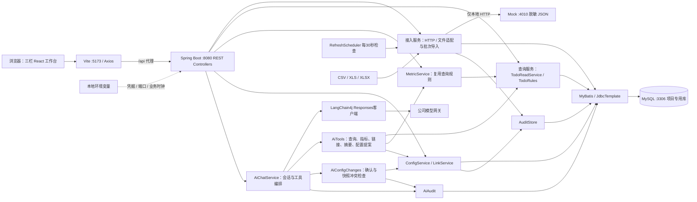
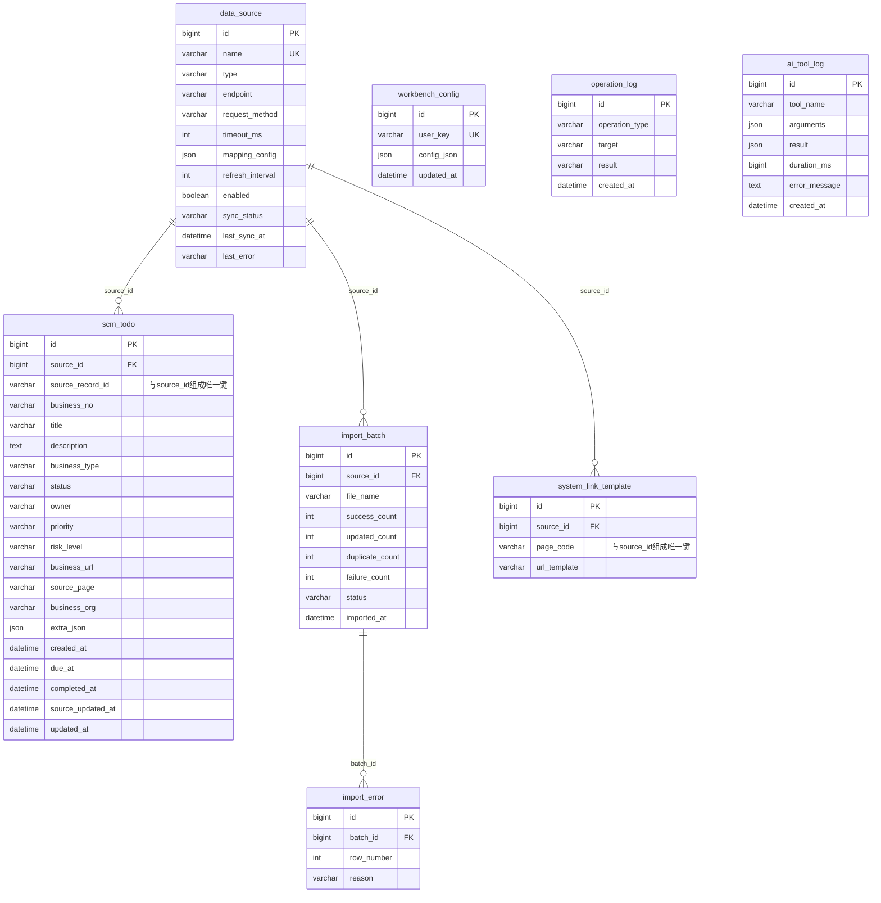
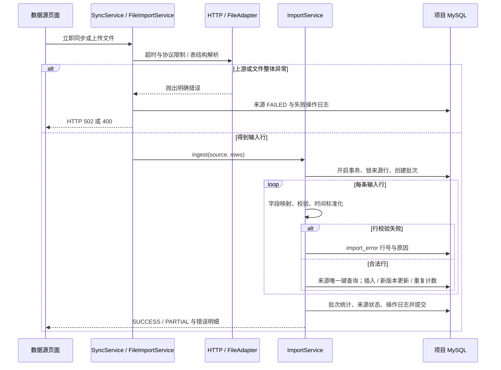

# SCM 工程最终验收与交付核对（2026-11-19）

## 资料和范围

以桌面原始任务书第7章、实习计划和总结要求为依据。本记录统一描述当前main实现，不再把历史轮次的测试数量或待办作为最终结果。原始资料与凭据不复制入库。已确认的开发前设计PDF保留原稿，实际差异在下方说明。

业务及AI已集成，八个默认导航、两种视图、六类工具和确认链路均已实现。2026-11-17完成主项目七场景集成，11-18完成人工演示与前端易用性修复，11-19完成本轮测试复现及资料收尾；不同日期证据分别标注。

## 第一轮审查与修复

| 原问题                                             | 本轮处理                                                                       |
| -------------------------------------------------- | ------------------------------------------------------------------------------ |
| 待办模型缺描述、来源页面、业务组织和扩展信息       | 增量增加 description、source_page、business_org、extra_json                    |
| 没有完成时间，无法准确计算处理时长、按时完成率     | 增加 completed_at；完成态必须有合法完成时间                                    |
| 数据源缺运行状态、刷新开关、最后同步和错误信息     | 补 enabled、sync_status、last_sync_at、last_error                              |
| 导入结果不能区分更新和重复                         | 增加 updated_count、status；成功数包含新增与更新，重复数单列                   |
| 第一轮 DATETIME 秒精度可能破坏带小数秒来源的幂等性 | 核心业务时间改为 DATETIME(6)，转换统一截断到微秒；重复导入测试覆盖             |
| 设计“即将逾期”上界与原任务书存在差异               | 以原任务书为准：未完成且 0 ≤ 剩余时间 < 配置阈值；精确上界不算即将逾期         |
| 统计和待办尚未实现，潜在多口径风险                 | 统一 TodoRules；指标一次读取数据快照、时间与阈值，避免单次响应内跨刷新口径变化 |
| Ant Design 5 + React 19 静态消息不兼容             | 官方兼容包 + AntApp 上下文消息；浏览器验证保存成功提示                         |
| 首轮“未就绪”页面                                   | 替换为可操作业务页面；删除旧空图表与静态导航重复定义                           |

保留八张表和已有外键，不覆盖原有表或数据，不需要架构推翻。迁移仅作用于项目库，项目专用账号补充 ALTER 权限。初始化脚本只忽略重复列错误，不忽略其他 DDL 失败。

## 实际部署架构（最终main）

AI分支5fd3af3已合入main；后续业务展示修复亦在main。以下为实际依赖边界。

进程边界为 MySQL、Mock、Spring Boot、Vite；后端仍是单体分层，不包含消息队列或微服务。服务监听回环地址。配置通过 Zustand 分发，业务请求统一经 Axios。`ai_tool_log`由AiAudit写入工具名、参数字段名、状态、耗时及脱敏错误，不存对话原文或凭据，真实六工具审计已验证。

## 模块边界及调用链

- SourceController → SourceService / SourceStore：配置校验与持久化。
- SyncService → ConfiguredHttpAdapter → ImportService.ingest（内部调用 TodoConverter）→ TodoMapper / MySQL：HTTP 接入。
- ImportController → FileImportService → FileAdapter → 同一转换与入库服务：CSV/XLS/XLSX。
- TodoController → TodoReadService → TodoRules / TodoMapper：查询与派生逾期字段。
- MetricController → MetricService → 同一 TodoReadService / TodoRules：指标、分布和趋势。
- ConfigController → ConfigService：人工配置持久化；AI配置由AiConfigChanges在显式确认后调用saveIfUnchanged，不能绕过确认层。
- LinkController → LinkService → 模板 + 待办服务 + AuditStore：变量编码、URL 校验、解析日志。
- React 页面 → Axios /api → Vite 代理 → REST；Zustand 管理配置，页面、图表、列表、AI 对话及证据面板分离。

`scm_todo(source_id, source_record_id)` 唯一；模板 `(source_id,page_code)` 唯一。配置使用本地演示用户 `demo`，未实现认证和多用户隔离（任务书不要求完整权限中心）。

### HTTP / 文件入库核心链路

数据库异常回滚整个批次；行校验异常只跳过该行。人工配置与日志在同一事务，审计失败则配置不生效。指标卡 `metric` → `/metrics/summary`；点击带 `view=metric`、时间窗口和筛选条件 → `/todos`；两条路径都复用 TodoRules。系统链接解析读取待办和模板，编码四个变量，验证最终 URL 后写 SYSTEM_JUMP 日志，只表达跳转意图。

## 工作台配置逐项核对

| 原任务书配置项                           | 实际持久化与呈现                                                     | 回归依据                                                                         |
| ---------------------------------------- | -------------------------------------------------------------------- | -------------------------------------------------------------------------------- |
| 卡片显示、名称、顺序、颜色、图标         | `cards` 对应字段；按序显示；app/chart/link 三种图标                  | 严格字段校验、浏览器改名保存与刷新                                               |
| 指标数据来源                             | `metric` 可选十项核心指标；`key` 保持组件身份；旧配置回退到 key      | MySQL 保存读取、前端规则测试、浏览器切换为逾期后20条下钻                         |
| 点击行为、时间范围、刷新频率             | DETAIL/NONE；1～365天；10～3600秒，各卡按自身频率轮询                | 参数边界测试、分组调度策略测试；3600秒整周期未做墙钟等待                         |
| 导航名称、上级、图标、排序、内外链、启用 | 递归按父子顺序排列、层级缩进；隐藏父级同时隐藏子级；页脚保留配置入口 | 循环/缺父级校验、前端多层及隐藏测试                                              |
| 快捷入口名称、图标、URL、AI提示词、顺序  | 人工配置并持久化；URL跳转；提示词通过快捷入口按钮送入AI助手          | URL/提示词类型与长度校验；已接通App/onPrompt；不宣称所有自定义提示词组合均已手测 |
| 基础布局、默认过滤/时间、AI展开          | 卡片显示与顺序、LIST/ANALYTICS、默认负责人/天数、aiExpanded          | 配置接口回归；清空负责人显式覆盖默认值                                           |

未增加任意拖拽网格；当前基础布局为任务书所列卡片显示/顺序和默认视图。配置入口为固定人工表单，非通用可视化页面设计器。

## 数据口径

- 时间：业务规则使用注入 Clock，Asia/Shanghai；日期字符串无偏移时按上海时间解释，有偏移时转换。验收固定为 2026-11-17 12:00:00 +08:00。运行健康检查、定时刷新与审计时间使用实际机器时间。
- 未完成：状态不为 COMPLETED。待办总数、高风险、逾期、即将逾期、今日到期均限未完成；今日新增包含当天创建的全部状态。
- 本周完成：周一 00:00 至业务当前时刻；平均时长为完成减创建；按时完成率为完成时间 ≤ 要求完成时间的完成任务占比。无完成任务时两个比率/均值返回 null，不伪造 0。
- `days` 指最近 N 个自然日内创建（截至业务当前时刻）的记录，各指标卡可设置自己的窗口；点击卡片携带该窗口进入明细。时间默认不由后端隐式加筛选。
- 新增趋势按创建日期分布；OVERDUE_TREND为最近N天到期且当前仍未完成的逾期记录，按到期日期分布，忽略创建窗口，保留负责人等条件。两者都不是历史每日逾期存量快照；明细使用view=OVERDUE及dueDays=N。
- 相同来源主键：新记录插入；来源更新时间更晚则更新；时间相同或更早则作为重复/旧版本跳过。时间精度统一微秒。不删除来源中本次未出现的历史记录。
- 批次对来源行加数据库锁，防止同来源并发插入竞争。合法行正常入库，校验错误写 import_error；真实数据库写入异常回滚批次，不被作为校验错误吞掉。
- CSV 行号是含表头的逻辑记录序号；Excel 是工作表实际行号。读取第一个工作表，不执行公式；公式行报告错误。文件上限 5MB、10000 行；损坏文件整体拒绝，记录失败来源状态与操作日志。
- HTTP GET/POST；仅允许配置项目 Mock 回环地址和端口，禁止自动跟随重定向，避免生产访问。自动刷新开启后每 30 秒检查一次是否达到配置分钟间隔；失败有持久化状态和日志。

## 最终测试与证据

| 检查               | 实际结果及证据                                                                                                                                                  |
| ------------------ | --------------------------------------------------------------------------------------------------------------------------------------------------------------- |
| 2026-11-19完整后端 | `SCM_AI_LIVE_TEST=true ./scripts/verify.sh`：41项，0失败、0错误、0跳过；`.runtime/integration-verify.log`及`backend/target/surefire-reports/TEST-*.xml`         |
| 前端               | 同次验证11项全部通过；TypeScript严格检查和生产构建通过                                                                                                          |
| Mock / 启停        | HTTP测试1项、隔离端口冲突和部分状态测试2项通过；现有四服务健康；双次结构初始化通过                                                                              |
| 模型               | 本次真实对话SCM_CHAT_OK及随机工具值往返通过。请求gpt-6.1-sol，网关响应metadata.modelName为gpt-6.2-sol，记录实际差异，未修改模型配置                             |
| 静态检查           | Google Java Format、Prettier、Black及Git空白检查；结果保存在现有`.runtime/integration-static.log`                                                               |
| 数据初始化         | 11-17主项目两次业务初始化保持100条，HTTP/CSV/Excel经实际业务链路；`.runtime/integration-business-1.log`、`integration-business-2.log`。本轮未重置用户数据与配置 |
| 六类AI工具         | 11-17主项目真实HTTP验收全部通过，含确认/取消、重放、多轮和来源故障；`.runtime/integration-ai.log`。本轮复测真实模型往返，不冒充重跑六工具全套                   |
| 浏览器及本人演示   | 11-18本人反馈完成七场景及补充配置/指标/摘要操作；代理实测见下表。本次收尾实测首页、真实AI指标查询和中文双击入口                                                                       |

后端用例分布：ApiTest 2、DatabaseIntegrationTest 1、BusinessIntegrationTest 13、HttpAdapterTest 4、AuditConsistencyTest 3、TodoRulesTest 6、OverdueTrendTest 3、AiChatServiceTest 6、AiConfigChangesIntegrationTest 2、CompanyModelTest 1。合计41。前端workbench-policy 3、presentation 2、aiPresentation 6，合计11。

固定验收口径：上海2026-11-17 12:00；100条记录、80未完成、20完成、2来源、3业务、10模板；逾期20、今日新增15、今日到期15、即将逾期15、高风险8、待审核10、待回复10、本周完成20、平均处理106小时、按时完成率50%。文件错误为CSV逻辑记录42/43/44，最新重复导入应重复40、错误3。文件来源PARTIAL是固定错误行的预期提示。个人演示用户40条待办、10逾期、8今日到期；演示同事40/10/7，不能混为全体统计。

## 七个场景与实际实现

| 场景         | 主项目验证结果                                                                    |
| ------------ | --------------------------------------------------------------------------------- |
| 工作台汇总   | 卡片、图表、列表与独立SQL一致；逾期20→采购7→高风险3；支持列表/统计切换            |
| AI查询       | 工具查询个人40/10/8，来源、业务更新时间及明细可见；前端依据工具结果直接表述数字   |
| 复杂筛选     | 采购逾期高风险3条，追问改库存后保留条件，3条；独立新问题不继承个人负责人          |
| 系统跳转     | 四变量编码和URL校验；真实rfq链接返回200，SYSTEM_JUMP记录解析/跳转意图             |
| 配置修改     | 提案无写入，取消不变，确认后持久化；过期/跨会话/重放/并发配置冲突有测试           |
| 数据源异常   | Mock503→后端502，数据保留；AI明确异常来源及范围，恢复来源后同步成功               |
| 错误文件导入 | 合法行正常入库、错误行可定位、新旧版本幂等；CSV、XLS/XLSX、公式行和损坏文件有测试 |

最终展示修复包含：指标及AI明细自动定位和中文条件、任务详情与深链接入口、FILE仅显示手动导入相关配置、工具数字直接结论、来源信息精简但不丢失、摘要纯文本处理、个人条件及重复点击定位。前端11项测试覆盖这些策略；不等于所有UI字段组合已穷尽手测。

## 第7章交付清单

| 要求                                     | 已有交付位置                                                                               | 核对结论                                                                    |
| ---------------------------------------- | ------------------------------------------------------------------------------------------ | --------------------------------------------------------------------------- |
| 前后端源码、数据库、Mock、测试数据、启停 | frontend/、backend/、database/、mock-service/、test-data/、scripts/                        | 齐全                                                                        |
| README、环境与模型配置、初始化和演示     | README.md、.env.example；真实.env忽略                                                      | 齐全；单独Maven不会自动读取.env，完整验证使用README命令                     |
| 需求与开发前工程设计                     | docs/SCM 智能工作台——需求与工程设计.pdf                                                    | 已存在，保留导师走查原稿；不重做设计                                        |
| 实际目录/职责/调用链/架构/ER             | 本记录上方、README、八表初始化及增量SQL                                                    | 已更新为含AI的实际main                                                      |
| API与工具定义                            | docs/business-api.md、运行时/v3/api-docs、docs/ai-assistant.md                             | 齐全                                                                        |
| 测试/格式/已知问题                       | 本记录，仓库测试及本地忽略运行证据                                                         | 齐全；历史原始日志不提交，命令可复现                                        |
| 演示材料 | README演示步骤；docs/delivery/SCM统一工作台｜正式汇报终稿.pptx | 正式PPT包含真实截图和10页演讲者备注；独立截图与本地操作笔记不提交 |
| 个人总结与汇报PPT | docs/delivery/SCM统一工作台-个人项目总结（最终版）.pdf；同目录正式汇报PPTX | 最终10页PPT、5页总结PDF已逐页渲染检查；仅提交唯一最终PDF/PPTX，Word编辑底稿留在本地 |
| 本人现场代码走查、测试复现               | 需要本人现场完成                                                                           | 自动化通过不能代替；七场景本人操作有11-18反馈记录                           |

设计与实现差异：保留八表，补齐完成时间、来源状态、批次更新计数及微秒时间；采用MyBatis与JdbcTemplate分工；统一TodoRules保证业务与AI口径；AI由LangChain4j Responses接入，通过Java确认端点执行写配置；JSON配置用于本地单用户，无微服务及复杂权限中心。

2026-11-19材料收尾与Mac入口复测：桌面两个中文.command入口调用仓库scripts/launch.sh，复用start/status。访达双击从项目服务停止状态启动成功，重复双击三个服务PID不变，第二个入口自动打开Safari工作台；MySQL共享服务保留且数据库查询正常。最小PATH、含空格项目路径和真实占用端口拒绝路径通过，失败不打开浏览器、不终止占用者。完整verify再次通过后端41项零跳过、前端11项、Mock1项、启停2项及构建；证据更新到.runtime/integration-verify.log。SQL仍为100条、80未完成、20逾期；截图中的真实get_metric工具成功返回20，日志可查。本次未改业务代码或重置验收数据。截图分别用于PPT第2/7页和总结图1/3，原架构、ER及技术主体内容保留。

## npm audit 告警评估（2026-11-19）

11-19首次资料核对时，11-18的`.runtime/build.log`曾记录“5 high severity vulnerabilities”及建议fix --force，但没有保存具体包、GHSA/CVE、受影响版本或利用条件，不能凭总数推断五个独立漏洞或宣称已经修复。该构建日志每次启动会覆盖，当前文件为中文入口复测的最新构建记录。

本轮对未改动的package-lock.json执行`npm audit --json`及显式`npm audit --registry=https://registry.npmjs.org --json`，均退出0：high=0、total=0（prod116/dev55/total170，含可选依赖计数）。当前锁定/安装关键版本为axios1.21.1、react-router-dom/react-router7.18.5、vite8.3.8。本轮未升级依赖、未运行audit fix、锁文件无改动。未复现的原因未确定，可能涉及当次依赖清单或审计数据变化，不能写成“5个high已修复”。

目前没有可定位的修复目标，不做未经验证的升级。`audit fix --force`可能跨既定范围及主版本，存在行为回归风险，见[npm官方说明](https://docs.npmjs.com/cli/audit/)。若重现，先保存完整JSON，逐项核对生产/开发依赖、路径、利用前提和补丁，再定向升级并回归。仅绑定回环地址降低开发服务暴露面，但不能作为忽略high的理由；audit为0也不是全量安全保证。

## 已知问题与验收边界

- 公司网关请求模型与本次响应标识不同（6.1→6.2），功能往返正常，现场如要求精确模型版本需向网关维护方确认；11-17历史6.1成功证据不改写。
- 本地单用户；查询在内存过滤，未做大数据压力测试；不同HTTP请求不承诺跨请求快照；会话在内存，刷新页面或重启会失去对话。
- 无历史每日逾期存量快照；仅提供创建分布及按到期日期的当前逾期分布，明确标注语义。
- 图表包大于500kB构建提示非阻断；导航为层级表单而非拖拽树；HTTP仅项目Mock，POST无自定义认证/请求体，不接生产。
- AI配置确认有快照冲突保护；人工完整JSON保存不提供通用多人编辑版本控制。3600秒卡片刷新仅验证调度策略，未等待整周期；模型故障为自动化注入，未人为破坏公司服务。
- 用户演示可能保留自定义名称；未擅自恢复配置。精确展示以当前页面为准，业务筛选依据key/metric。
- 正式个人总结PDF与PPTX已纳入docs/delivery/；现场代码走查、本人测试复现及导师最终验收仍需本人完成。
- 原始需求与工程设计PDF共7页，工程设计跨第3至7页，与任务书“开发前工程设计1～2页”的篇幅要求存在差异。该稿此前已由导师走查，本轮保留原稿；提交时应说明其为需求与设计合订稿，篇幅接受情况需本人向导师确认，不在收尾阶段另造一份设计。

## GitLab 最终材料归档核对（2026-11-19）

再次核对原始实习说明、计划表、任务书7.1～7.4及总结要求，复用已有全部工程交付项。正式PPTX（10页、含10页备注）及总结PDF（5页、含实际架构、ER和工程实现章节）从桌面最终版原样复制到`docs/delivery/`，文件哈希一致，结构及全文可读取；与此前逐页渲染检查的版本一致。总结要求为建议6～8页且明确不必凑页数，本次保留5页最终排版。

核对现有Surefire XML与11-19完整验证日志：后端41项、0失败、0错误、0跳过，前端11项通过；Mock1项、启停2项及构建通过。此轮只归档材料及更新文档索引，未重跑业务测试或修改业务逻辑，未将材料核对表述为新一轮全套功能验收。原始运行日志、测试XML与中间截图仍仅保存在本地忽略目录；正式结果及复现命令见本报告和README。

全部已跟踪文件、main历史内容及两份正式材料经过本地凭据匹配和常见密钥模式检查，未发现真实密钥。已跟踪文件中未发现环境文件、运行日志、缓存、Word底稿或重复草稿，无需删除工程文件。公司原始资料及实习日志未复制到仓库；已有代码说明性提交保留，不改写历史。
