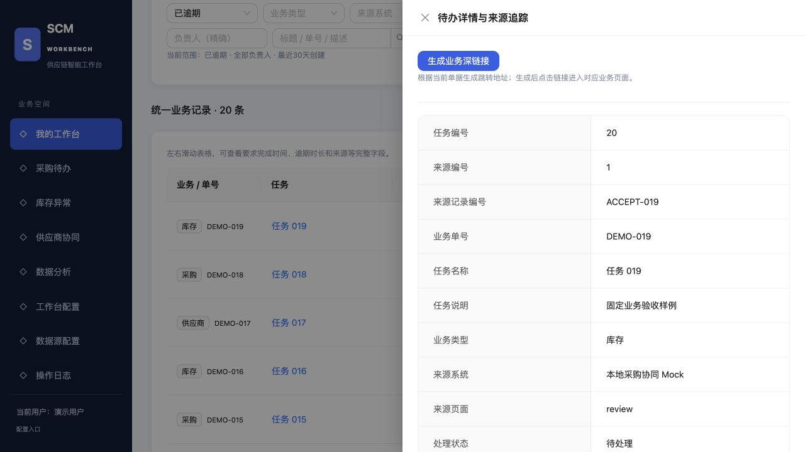
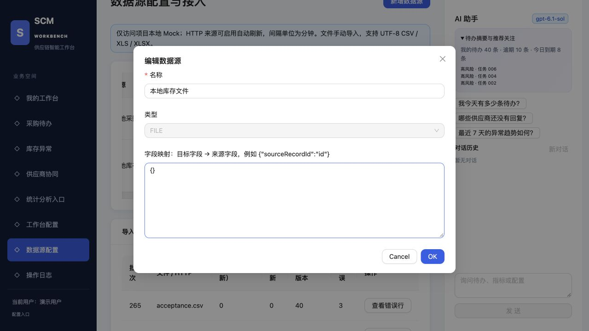

# 已完成的业务演示及任务书对应关系

## 启动项目

Mac 打开“终端”，依次执行：

```sh
cd /Users/dongyuhang/Projects/scm-ai-workbench
./scripts/stop.sh
SCM_FIXED_NOW=2026-11-17T04:00:00Z ./scripts/start.sh
./scripts/status.sh
curl -fsS http://127.0.0.1:5173/api/workbench/status
```

看到三个服务均为 `200`、数据库 `UP`、存储记录 `100` 后，打开 <http://127.0.0.1:5173>。首页业务时间应为 **2026-11-17 12:00:00**。

以下结果基于现有固定数据，默认负责人留空，无需重新初始化。演示结束执行 `./scripts/stop.sh` 停止项目。

## 1. 工作台汇总

对应任务书：§6.2 场景一；§2.1 页面、§2.3 待办、§2.4 指标联动。

**操作**

1. 左侧点“我的工作台”，查看中间指标卡。
2. 点击“已逾期”卡片的 **20**，页面定位到“统一业务记录”。
3. 点该区域右侧“统计分析”，点击业务类型图下方的“采购: 7”，再点击风险图下方的“高风险: 3”。
4. 切换“列表视图”，点击蓝色任务名称查看详情。

**预期结果**

- 首页待办总数 80、已逾期 20、高风险 8。
- 筛选后的记录数依次为 **20 → 7 → 3**。
- 最后三条单号为 `DEMO-000、DEMO-003、DEMO-006`，均为采购、已逾期、高风险。
- 列表与图表数量一致，任务详情可以打开。

**结束操作**：关闭详情，点击筛选栏“重置筛选”。

## 2. AI 查询

对应任务书：§6.2 场景二；§3.1 汇总工具、§3.2 回答规范。

**操作**：在右侧 AI 助手开启“新对话”，复制以下内容到输入框，点“发送”：

```text
我今天有多少条待办？
```

**预期结果**

| 负责人 | 待办总数 | 今日新增 | 今日到期 | 已逾期 | 高风险 |
| --- | ---: | ---: | ---: | ---: | ---: |
| 演示用户 | 40 | 8 | 8 | 10 | 4 |

- 回答展示查询条件、来源、数据更新时间和明细入口。
- 点“查看待办”应显示 40 条；点“查看逾期”应显示 10 条。
- 左侧“操作日志” → “AI 调用” → “刷新”，能看到 `get_todo_summary` 成功。

## 3. 复杂筛选

对应任务书：§6.2 场景三；§2.3 组合筛选、§3.1 明细工具。

**操作**：在右侧 AI 输入并发送：

```text
查询全部负责人的采购类、已逾期且高风险的任务。
```

**预期结果**：3 条，单号为 `DEMO-000、DEMO-003、DEMO-006`；条件包含全部负责人、采购、已逾期、高风险；`search_todos` 调用成功。点明细入口核对同样三条记录。

在同一对话继续发送：

```text
按刚才的筛选条件，换成库存。
```

**预期结果**：保留其他筛选条件，改为库存；3 条，单号为 `DEMO-001、DEMO-004、DEMO-007`。

## 4. 系统跳转

对应任务书：§6.2 场景四；§3.1 链接工具、§3.4 深链接。

**操作**：右侧开启“新对话”，发送：

```text
打开待审核询价页面。
```

1. 从回答中的候选单据选择一个业务链接。
2. 对比新标签页面的业务单号与所选单据。
3. 左侧“操作日志” → “业务操作” → “刷新”，查看跳转记录；在“AI 调用”查看工具记录。

**预期结果**：打开本地 Mock 业务页，询价页面和单号正确；有 `SYSTEM_JUMP / RESOLVED` 记录及成功的 `get_system_link` 调用。

**手工入口**：待办列表点蓝色任务名称 → 详情顶部“生成业务深链接” → “打开业务页面 ↗”，同样能进入对应单据。

**结束操作**：关闭新标签页，回到工作台。



## 5. 配置修改

对应任务书：§6.2 场景五；§3.3 二次确认、§3.4 配置持久化。

**操作**：记下“已逾期”卡片原来的位置，右侧发送：

```text
把已逾期卡片放到第一位。
```

1. 查看修改预览，先不确认，再点击“取消”。
2. 重新发送同一句话，点击“确认修改”。
3. 按 ⌘R 刷新页面。

**预期结果**：未确认和取消时卡片位置不变；确认后移到第一位，刷新仍保留。

**恢复**：左侧“工作台配置”，将“已逾期”卡片排序改回原值并保存。

## 6. 数据源异常与 HTTP 接入

对应任务书：§6.2 场景六；§2.2 HTTP 接入、§3.2 异常来源说明。

**操作**

1. 左侧“数据源配置”，在“本地采购协同 Mock”一行点“配置”。检查请求为 GET、URL 为下面地址，关闭弹窗后点“同步”：

```text
http://127.0.0.1:4010/api/acceptance
```

**预期结果**：正常重复同步得到 **重复 60、失败 0**，待办不增加。

2. 再点“配置”，仅将 URL 换成以下地址并保存，再点“同步”：

```text
http://127.0.0.1:4010/api/failure
```

3. 右侧 AI 发送：

```text
我今天有多少条待办？
```

**预期结果**：HTTP 来源显示失败；已有记录保留；AI 指出“本地采购协同 Mock”不可用或数据可能滞后。首页未完成仍为 80 条。

**恢复**：把 URL 改回 `http://127.0.0.1:4010/api/acceptance`，保存并再次“同步”，确认来源恢复成功。回“我的工作台”点“刷新数据”。

## 7. 错误文件导入与重复识别

对应任务书：§6.2 场景七；§2.2 CSV/Excel 接入、校验与幂等。

**操作**

1. 左侧“数据源配置” → “本地库存文件”一行点“导入文件”。文件选择框按 ⌘⇧G，粘贴路径并选取：

```text
/Users/dongyuhang/Projects/scm-ai-workbench/test-data/acceptance.csv
```

2. 查看结果，再上传同一文件一次。
3. 用同一按钮上传 Excel 样例：

```text
/Users/dongyuhang/Projects/scm-ai-workbench/backend/target/test-fixtures/acceptance.xlsx
```

**预期结果（已有固定数据时）**

| 文件 | 成功 | 重复 | 失败 | 错误位置 |
| --- | ---: | ---: | ---: | --- |
| CSV，两次结果相同 | 0 | 40 | 3 | 42 行缺标题；43 行日期错误；44 行风险等级非法 |
| Excel | 0 | 1 | 1 | 3 行包含公式 |

“导入 / 同步批次”中点击“查看错误行”，能看到行号和原因。导入后仍为 100 条存储记录；正常记录没有因错误行丢失。

**恢复**：最后再上传一次 `acceptance.csv`，最近结果回到“重复 40、失败 3”。文件来源显示“部分失败”符合预期。



## 补充功能

### 近七天逾期指标（§3.1 get_metric）

右侧开启新对话并发送：

```text
查询全部负责人最近7天的逾期量，按到期日期统计，并说明统计口径。
```

**预期**：总计 20 条，均在 11 月 16 日到期；点击“查看指标对应明细”定位到 20 条任务。这里统计当前仍逾期的任务，按到期日期分布。

### 供应商催办摘要（§3.1 generate_business_summary）

右侧开启新对话并发送：

```text
查询全部负责人尚未回复的供应商任务，并据此生成一段礼貌的催办话术。
```

**预期**：4 条，单号为 `DEMO-050、DEMO-053、DEMO-056、DEMO-059`；生成催办草稿，日志包含查询和摘要工具成功记录。文字措辞可以不同，数量、单据和条件应一致。

### 人工工作台配置（§3.4）

左侧“工作台配置”，分别改一个指标卡、导航、快捷入口名称，保存后刷新，应保留；默认负责人设为“演示用户”，首页未完成/逾期为 **40/10**，清空后为 **80/20**。测试后恢复原名称和默认负责人并保存。

## 数量核对入口

在浏览器新标签打开下面地址，与页面或 AI 结果比较：

| 核对内容 | 只读接口 | 预期 |
| --- | --- | --- |
| 入库记录 | <http://127.0.0.1:5173/api/workbench/status> | storedTodoCount = 100 |
| 全体指标 | <http://127.0.0.1:5173/api/metrics/summary> | TOTAL=80、OVERDUE=20、HIGH_RISK=8 |
| 个人指标 | <http://127.0.0.1:5173/api/metrics/summary?owner=演示用户> | TOTAL=40、OVERDUE=10、TODAY_DUE=8 |
| 采购逾期高风险 | <http://127.0.0.1:5173/api/todos?view=OVERDUE&businessType=PROCUREMENT&riskLevel=HIGH> | total=3 |
| 七天逾期 | <http://127.0.0.1:5173/api/metrics/overdue-trend?trendDays=7> | total=20 |
| 供应商待回复 | <http://127.0.0.1:5173/api/todos?view=PENDING_REPLY&businessType=SUPPLIER> | total=4 |
